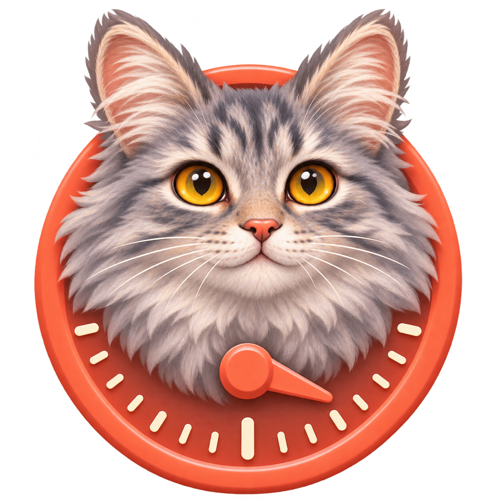

<p align="center">
  
</p>

<h1 align="center">MoneList</h1>

<p align="center">A to-do list and Pomodoro timer for macOS, with a cat mascot.</p>

<p align="center">
  <a href="https://github.com/riskaameliya/monelist/releases">Download DMG</a> ·
  <a href="#build-from-source">Build from source</a> ·
  <a href="#project-structure">Project structure</a>
</p>

## Install on macOS

MoneList requires **macOS 13 Ventura or later**. The DMG from GitHub Releases supports **Apple Silicon and Intel**.

1. Download `MoneList-<version>.dmg` from [GitHub Releases](https://github.com/riskaameliya/monelist/releases).
2. Open the DMG and drag **MoneList** to **Applications**.
3. Open MoneList from **Applications**.

> The release build is ad-hoc signed and has no notarization ticket. Gatekeeper may block the app on first launch.

## How to use MoneList

| Feature | How to use it |
| --- | --- |
| **To-do list** | Type in **Tambah tugas…** (Add a task) and press Enter. Drag the **☰** handle to reorder tasks. Check off a task to move it to **Selesai** (Completed), or click **Hapus yang selesai** (Clear completed) to empty that section. |
| **Pomodoro timer** | Click the target icon beside a task to track its focus sessions, or run the timer on its own. Use the timer controls to pause, reset, or skip a session. |
| **Mini panel** | Click the minimize button in the upper-right corner to see the time remaining and control the timer from another Space. Drag the icon or countdown to move the panel. |
| **Cat mascot** | The cat's expression changes with the timer phase. A meow marks the end of each focus session or break. |

By default, each focus session lasts **25 minutes**, a short break lasts **5 minutes**, and every fourth focus session is followed by a **15-minute long break**. Use the gear icon to change the focus duration. To restart the cycle, click the **sesi fokus** (Focus sessions) count and choose **Reset hitungan sesi fokus** (Reset focus session count).

MoneList stores tasks, timer settings, session counts, and the panel position locally. The app may ask for permission to show notifications when sessions end.

## Build from source

Install **Xcode Command Line Tools** and **FFmpeg**. The second command uses Homebrew.

```bash
xcode-select --install
brew install ffmpeg
```

Run these commands from the project directory.

```bash
./build.sh
open build/MoneList.app
```

A local build targets the architecture of the Mac that runs it. To create a universal DMG with matching version numbers for the app and disk image, run these commands.

```bash
ARCHS="arm64 x86_64" VERSION=1.0.0 ./build.sh
./scripts/make-dmg.sh 1.0.0
```

The DMG is saved to `build/MoneList-1.0.0.dmg`. FFmpeg converts `cat-meow.ogg` to CAF during the build. Installing from the DMG requires only the packaged app.

## Project structure

```text
MoneList/
├── .github/workflows/
│   └── release.yml          # Builds the universal DMG and uploads it to GitHub Releases
├── Sources/TodoPomo/
│   ├── TodoPomoApp.swift     # SwiftUI app entry point
│   ├── ContentView.swift    # Main window and mini panel
│   ├── TodoStore.swift      # Task list and local storage
│   ├── PomodoroTimer.swift   # Timer, sound, and notifications
│   └── Resources/           # Logo, mascot, and cat-meow.ogg
├── scripts/
│   ├── create-app-icon.swift # Generates the app icon
│   └── make-dmg.sh           # Packages the app into a DMG
├── docs/
│   └── RELEASE.md            # Release guide for maintainers
├── Info.plist                # macOS app metadata
└── build.sh                  # Compiles the app and creates the .app bundle
```

See the [maintainer release guide](docs/RELEASE.md) to publish a new version.
